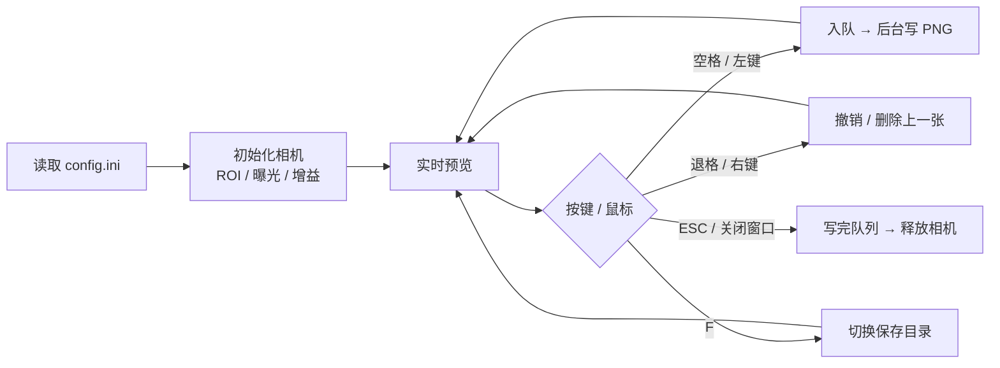

<div align="center">

# 📷 Blackfly USB3 图像采集工具


[快速开始](#-快速开始) · [按键与提示](#-按键与预览提示) · [配置文件](#-配置文件) · [从源码构建](#-从源码构建) · [直接使用](#-直接使用) · [常见问题](#-常见问题)

</div>

<!-- 截图：把预览窗口截图放到 docs/preview.png，然后取消下一行注释
<p align="center"></p>
-->

---

## ✨ 特性

| | |
|---|---|
| ⚡ **低延迟预览** | 只取最新帧；画面上只有一条简洁的状态条、底部按键提示和每次操作的结果，保存时画面边缘闪一圈白光，支持 `+/-` 实时缩放 |
| 🖱️ **键盘 / 鼠标都能操作** | 预览画面内**左键保存、右键删除上一张**，和空格、退格完全等价 |
| 🔢 **自动接续编号** | 启动或切换目录时扫描目标文件夹，从"已有最大编号 + 1"开始，**绝不覆盖已有图片** |
| 🧵 **保存不卡预览** | PNG 编码和写盘在后台线程完成，主线程只做一次内存拷贝 |
| 🈶 **中文路径** | 保存目录、文件名前缀、配置文件路径都可以含中文和空格，运行中按 `F` 可随时切换保存目录 |
| ⚙️ **配置文件** | 前缀、起始编号、保存目录、ROI、曝光、增益都在 `config.ini`，命令行可临时覆盖 |
| 🛡️ **安全退出** | `ESC`、点击预览窗口 ✕、Ctrl+C、直接点控制台 ✕ 都会先停采集、写完队列里的图片，再释放相机 |

## 🔄 工作流程



## 🚀 快速开始

1. 安装 **Spinnaker 驱动**，相机接 USB3 口，设备管理器里没有黄色感叹号
2. 关闭 SpinView 等会占用相机的软件
3. 打开 `config.ini`，至少改 `save_folder`（保存目录）和 `prefix`（文件名前缀）
4. 双击以管理员身份运行 exe **需要管理员权限**

## ⌨️ 按键与预览提示

| 操作 | 功能 |
|:---:|---|
| <kbd>空格</kbd> / 鼠标**左键** | 保存当前帧 |
| <kbd>退格</kbd> / <kbd>Delete</kbd> / 鼠标**右键** | 删除**当前目录本次运行**保存的上一张（不会动以前留下的文件，也不跨目录撤销） |
| <kbd>F</kbd> | 弹出文件夹选择对话框，运行中切换保存目录（`start_index = auto` 时自动按新目录续编号） |
| <kbd>+</kbd> / <kbd>-</kbd> | 放大 / 缩小预览窗口（仅影响预览，不影响保存的原图） |
| <kbd>ESC</kbd> / 点击预览窗口 ✕ | 安全退出 |

> [!NOTE]
> 鼠标操作只在鼠标落在**预览画面内**时生效，点标题栏和窗口边框不会触发。右键每点一次就删一张，连续点会一直往回删，直到本次运行保存的图删完为止，请留意。

预览**左上角是一条状态条**：状态点（🟢 正常 / 🟡 正在写盘 / 🔴 有失败）、帧率、`#编号`（下一张的编号）、已保存张数，写盘中和失败的数量只在大于 0 时才出现，最后是原图分辨率；宽度不够时会自动先隐藏分辨率。**底部是按键提示条**，启动 8 秒后会自动变淡，不抢画面。每次保存或删除的结果会在按键条上方以居中小条显示：

| 颜色 | 含义 |
|:---:|---|
| 🟡 黄 | 已入队，正在写盘：`Saving #12 ...` |
| 🟢 绿 | 写盘成功 `Saved OK #12`，或删除成功 `Deleted #12` |
| 🔴 红 | 写盘失败、目标已存在（拒绝覆盖）、队列已满、删除失败 |

> [!TIP]
> `Saved OK` 是后台线程确认文件真正写到磁盘后才显示的，不是按下空格的瞬间。画面上只显示英文，路径等详细信息在控制台。预览偏小时，把 `preview_scale` 调到 `0.3` 以上，文字和提示条会更舒服。

## 🗂️ 文件命名

| `prefix` | 生成的文件 |
|---|---|
| 留空 | `0.png` `1.png` `2.png` … |
| `GroupA_` | `GroupA_0.png` `GroupA_1.png` `GroupA_2.png` … |

- 编号按前缀分别统计，`GroupA_*` 和 `GroupB_*` 互不影响
- 目标文件已存在时，程序拒绝保存并跳到下一个空闲编号，再保存一次即可
- 前缀里不能含 `\ / : * ? " < > |`

## ⚙️ 配置文件

默认读取 **exe 所在目录**的 `config.ini`，找不到会自动生成一份默认的。请用 **UTF-8** 保存；行首 `;` 或 `#` 为注释，不支持行尾注释。

<details>
<summary><b>展开全部配置项</b></summary>

<br>

| 配置项 | 默认值 | 说明 |
|---|:---:|---|
| `prefix` | 空 | 文件名前缀 |
| `start_index` | `auto` | 起始编号；`auto` 自动接续，也可填数字 |
| `save_folder` | `.` | 保存目录，不存在会自动创建 |
| `png_compression` | `1` | PNG 压缩级别 0–9：1 最快，9 文件最小但编码很慢 |
| `writer_queue_size` | `32` | 后台写盘队列最多缓存的帧数，每帧约 4 MB |
| `preview_scale` | `0.2` | 预览缩放比例（运行中可用 `+/-` 调整） |
| `width` / `height` | `2048` | ROI 宽高，按相机步进自动对齐 |
| `offset_x` / `offset_y` | `center` | ROI 偏移：`center` 在传感器上居中，或填像素值 |
| `exposure_us` | `keep` | 曝光时间（微秒）：`keep` 不改、`auto` 自动、或填数值 |
| `gain_db` | `keep` | 增益（dB）：`keep` / `auto` / 数值 |
| `buffer_count` | `3` | 相机端缓冲区数量，越小延迟越低但越容易丢帧 |
| `pause_on_exit` | `true` | 退出时是否等待回车 |

</details>

**命令行覆盖**（优先级：内置默认值 < `config.ini` < 命令行）：

```powershell
# 临时换前缀和曝光
.\SpinnakerAcquisition.exe --prefix=sampleA --exposure_us=8000

# 使用指定位置的配置文件（例如全组共用一份）
.\SpinnakerAcquisition.exe --config=\\server\share\config.ini

# 查看所有参数
.\SpinnakerAcquisition.exe --help
```

> [!TIP]
> 想让全组参数统一，就把 `exposure_us`、`gain_db`、`width`、`height` 写成具体数值，不要用 `keep`。

## 🔨 从源码构建

<details>
<summary><b>展开构建步骤（Windows）</b></summary>

<br>

**环境**

- Visual Studio 2022（含"使用 C++ 的桌面开发"）
- CMake ≥ 3.10
- OpenCV 预编译版（需要 `opencv_world*.dll`）
- Spinnaker SDK，项目目录下需要有 `include/` 和 `lib64/vs2015/`

预览上的文字用 Windows 自带的 GDI 渲染（Segoe UI），不需要额外的字体库或 OpenCV contrib 模块。

**步骤**

1. 打开 `CMakeLists.txt`，把 OpenCV 路径改成自己的：

   ```cmake
   set(OpenCV_DIR "D:/CppLibrary/opencv/build")   # 指向 OpenCVConfig.cmake 所在目录
   ```

2. 构建（请用 **Release**）：

   ```powershell
   cmake -S . -B build -G "Visual Studio 17 2022" -A x64
   cmake --build build --config Release
   ```

3. 产物在 `build\bin\Release\`，构建后会自动复制到 exe 旁边：

   | 文件 | 说明 |
   |---|---|
   | `config.ini` | 只在目标处不存在时复制，不会覆盖已改过的配置 |
   | `opencv_world*.dll` | 自动在 `OpenCV_DIR` 下查找 |
   | `*Spinnaker*.dll` | 自动在项目目录和默认安装目录查找；找不到时用 `-DSPINNAKER_BIN_DIR="…/bin64/vs2015"` 指定 |

> [!IMPORTANT]
> 源码含中文，MSVC 必须以 UTF-8 编译。`CMakeLists.txt` 已加 `/utf-8`；如果用自己的工程文件，请手动加上，否则编译时 `static_assert` 会报错提醒。

</details>

## 📦 直接使用

只要有 **`build\bin\Release\`** 整个文件夹即可，不需要整个项目。发之前确认里面有：exe、`config.ini`、`opencv_world*.dll`、几个带 `Spinnaker` 字样的 DLL。

电脑需要：

- [x] 64 位 Windows，并已安装 **Spinnaker 驱动**（DLL 只是库，相机驱动复制不了）
- [x] 提示缺 `VCRUNTIME140.dll` / `MSVCP140.dll` 时，安装 Visual C++ 2015–2022 x64 运行库
- [x] 解压到普通文件夹（桌面、D 盘），不要放 `C:\Program Files`
- [x] 从聊天软件收到的压缩包，解压前先右键 → 属性 → 勾选"解除锁定"

> [!WARNING]
> 请使用 **Release** 构建的版本。Debug 版依赖调试运行库，在别的电脑上多半跑不起来。

## ❓ 常见问题

<details>
<summary><b>提示 <code>Number of cameras detected: 0</code></b></summary>

<br>检查 USB3 线和接口；设备管理器里是否有黄色感叹号（驱动未装好）；SpinView 等软件是否占用了相机。
</details>

<details>
<summary><b>双击后闪退，提示缺少 DLL</b></summary>

<br>看 `Release` 文件夹里的 DLL 是否齐全；缺 `VCRUNTIME140.dll` / `MSVCP140.dll` 就装 VC++ 运行库。
</details>

<details>
<summary><b>画面卡顿、延迟大</b></summary>

<br>控制台会打印实际帧率和曝光时间。曝光太长会直接拉低帧率，调小 `exposure_us`。
</details>

<details>
<summary><b>红色 <code>SAVE FAILED</code></b></summary>

<br>看控制台里的详细原因：磁盘已满、目录没有写入权限、文件被其他程序占用。
</details>

<details>
<summary><b>红色 <code>REFUSED: #N exists</code></b></summary>

<br>目标编号已经有文件（比如手动设置了 `start_index`）。程序已自动跳到下一个空闲编号，再保存一次即可。
</details>

<details>
<summary><b>红色 <code>QUEUE FULL</code></b></summary>

<br>磁盘写入跟不上。稍等一下再按，或调小 `png_compression`、增大 `writer_queue_size`。
</details>

<details>
<summary><b>鼠标右键误删了图</b></summary>

<br>右键和退格完全等价，每次删除本次运行保存的上一张。误删后只能重新拍；没存过的图不会被删，以前留下的文件也不会被动。
</details>

<details>
<summary><b>启动时提示 <code>Failed to create file in current folder</code></b></summary>

<br>当前目录没有写权限，换到桌面或 D 盘等普通文件夹运行。
</details>

## 📁 目录结构

```text
.
├── main.cpp               程序入口（配置加载、相机枚举与退出流程）
├── acquisition.h/.cpp     采集主循环、键盘/鼠标交互与预览调度
├── async_writer.h/.cpp    后台异步 PNG 编码与原子写盘线程
├── camera_setup.h/.cpp    相机初始化（ROI、曝光/增益、低延迟流模式）
├── config.h/.cpp          config.ini 与命令行参数解析与校验
├── console_ctrl.h/.cpp    控制台 UTF-8 输出与关闭信号处理
├── file_naming.h/.cpp     文件命名与已有最大编号扫描
├── folder_dialog.h/.cpp   Windows 文件夹选择对话框（运行中切换目录）
├── guards.h               相机与图像缓冲区 RAII 资源守卫
├── overlay.h/.cpp         预览画面状态条、按键提示条、结果提示条与保存闪光绘制
├── text_render.h/.cpp     抗锯齿文字渲染（Windows 用 GDI，其它平台退回 OpenCV 字体）
├── platform.h             Windows 头文件统一封装
├── text_utils.h/.cpp      UTF-8 / 路径转换与命令行宽字符工具
├── CMakeLists.txt         构建脚本（含构建后自动复制 DLL 与 config.ini）
├── config.ini             配置文件模板
├── app.rc / icon.ico      图标资源
├── include/               Spinnaker SDK 头文件
└── lib64/vs2015/          Spinnaker SDK 库文件
```

## ⚠️ 已知限制

- 目前只在 Windows 上完整适配；Linux 下需自行确认 Spinnaker 安装路径、相机 udev 权限和 OpenCV 的 GUI 支持
- 非 Windows 平台预览文字会退回 OpenCV 自带字体，样式会简陋一些
- 只使用检测到的第一台相机
- 保存格式固定为 PNG（8 位灰度）